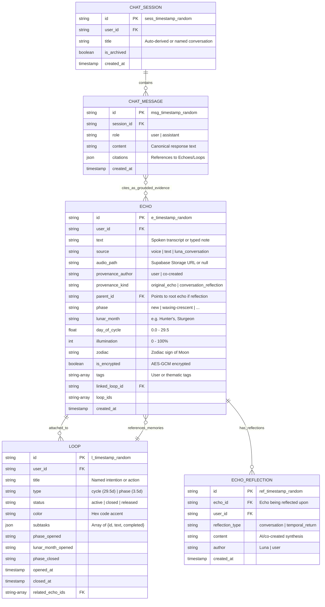
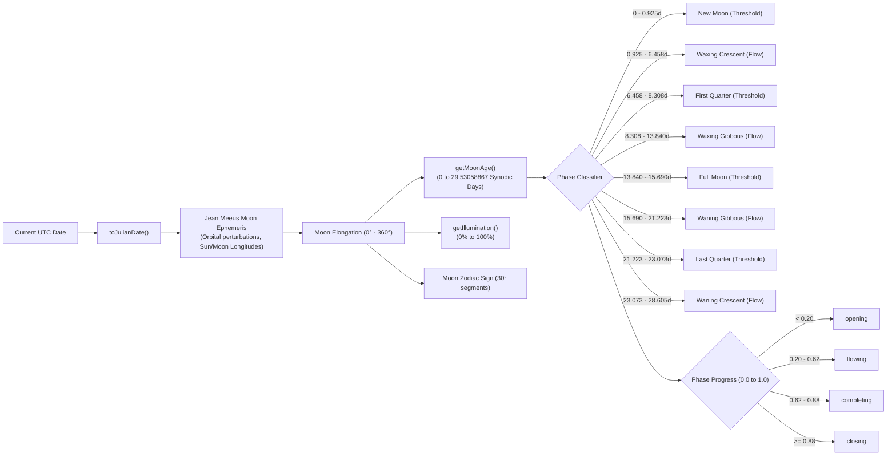

# Luna Design-Facing Architecture & Workflow Diagrams

These diagrams provide Astra with clear visual maps of Luna's information architecture, data entity models, recording lifecycles, and lunar engine pipeline.

---

## 1. Information Architecture & Navigation Map

```mermaid
flowchart TD
    App["App Shell (src/App.jsx)"]
    
    subgraph Navigation ["Persistent Bottom Navigation"]
        TabSky["☽ Sky Tab"]
        TabLoops["◯ Loops Tab"]
        TabEchoes["◎ Echoes Tab (The Field)"]
        TabRhythm["〜 Rhythm Tab"]
        TabChat["✦ Chat Tab"]
    end
    
    subgraph SkySurfaces ["Sky Surfaces"]
        SkyMain["Sky Main View\n(MoonFace + Tide Bar + Zodiac)"]
        DeepSheet["Deep Cosmic Sheet\n(Exact windows, Season, Natal)"]
        ProfileDrawer["Profile & Settings Menu\n(Theme, Voice, Encryption, Export)"]
    end
    
    subgraph LoopSurfaces ["Loop Surfaces"]
        LoopsFeed["Loops View (Cycle & Phase)"]
        LoopSheet["Loop Creation Sheet"]
        RitualModal["New Moon Ritual Modal"]
        LoopDetail["Loop Subtasks & Linked Echoes"]
    end
    
    subgraph EchoSurfaces ["Echo Surfaces (The Field)"]
        EchoIdle["Idle Entrance\n(Prod Button Pair vs Codex EchoEntry)"]
        EchoComposer["Active Composer\n(Recording / Transcription / Editing)"]
        DraftBanner["Recovered Drafts Banner\n(Device-local Audio Recovery)"]
        EchoList["Chronological Echo Stream\n(Voice & Text Cards)"]
        VoiceQueue["Continuous Voice Playback Bar"]
    end
    
    subgraph ChatSurfaces ["Chat Surfaces"]
        ChatMain["Active Conversation Flow"]
        SessionDrawer["Chat Sessions History Drawer\n(Active vs Archived)"]
        VoicePlayback["Speech Synthesis\n(Nova / Nicole TTS Player)"]
    end

    App --> Navigation
    TabSky --> SkyMain
    SkyMain --> DeepSheet
    SkyMain --> ProfileDrawer
    
    TabLoops --> LoopsFeed
    LoopsFeed --> LoopSheet
    LoopsFeed --> RitualModal
    LoopsFeed --> LoopDetail
    
    TabEchoes --> EchoIdle
    EchoIdle --> EchoComposer
    TabEchoes --> DraftBanner
    TabEchoes --> EchoList
    EchoList --> VoiceQueue
    
    TabChat --> ChatMain
    ChatMain --> SessionDrawer
    ChatMain --> VoicePlayback
```



---

## 2. Personal Field Entity Relationship Model



---

## 3. Echo Voice Recording & Resilient Draft Lifecycle

```mermaid
sequenceDiagram
    autonumber
    actor Person as User
    participant UI as EchoEntry / Echoes Tab
    participant IDB as Local IndexedDB (luna_audio_drafts)
    participant Whisper as Transformers.js (Local Client)
    participant Cloud as Supabase Storage & DB

    Person->>UI: Tap "Begin speaking"
    UI->>UI: Request microphone stream
    Note over UI: Button enters "Opening microphone…" (debounced)
    UI->>UI: MediaRecorder starts (audio/webm;codecs=opus)
    Person->>UI: Speaks thought / memory
    Person->>UI: Tap "STOP RECORDING"
    UI->>IDB: 1. SAVE DRAFT AUDIO IMMEDIATELY (blob, metadata, status: 'draft')
    Note over IDB: Audio is safely on device even if tab is closed
    UI->>Whisper: 2. Run local transcription (WASM / WebGPU)
    Whisper-->>UI: Return transcript text
    UI->>IDB: Update draft with transcript text
    UI->>UI: Open review composer (audio preview + editable text)
    Person->>UI: Tap "ECHO ↩" (Save)
    UI->>IDB: Update draft status: 'saving'
    UI->>Cloud: Upload audio blob to storage
    alt Upload Succeeded
        Cloud-->>UI: Return storage path
        UI->>Cloud: Insert Echo row in Supabase
        Cloud-->>UI: Confirmed Echo saved
        UI->>IDB: Update status: 'synced' -> deleteDraftAudio()
        UI->>UI: Add Echo to stream, clear composer
    else Network / Upload Failed
        Cloud--xUI: Upload failed
        UI->>IDB: Update draft status: 'failed'
        UI->>Person: Alert: "Audio saved safely on device. You can retry anytime."
        UI->>UI: Render in "Recovered Drafts" banner
    end
```

---

## 4. Lunar Engine & Phase Pipeline


